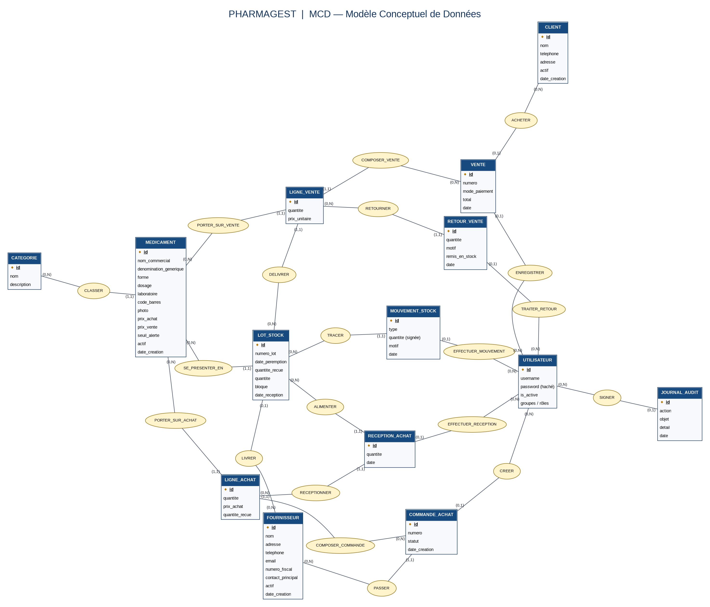
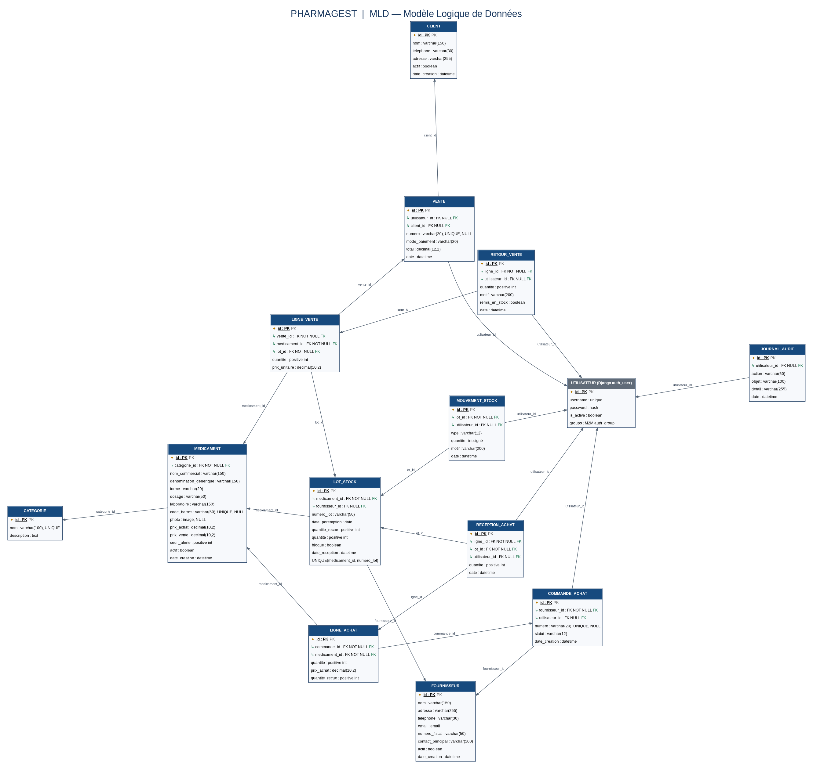
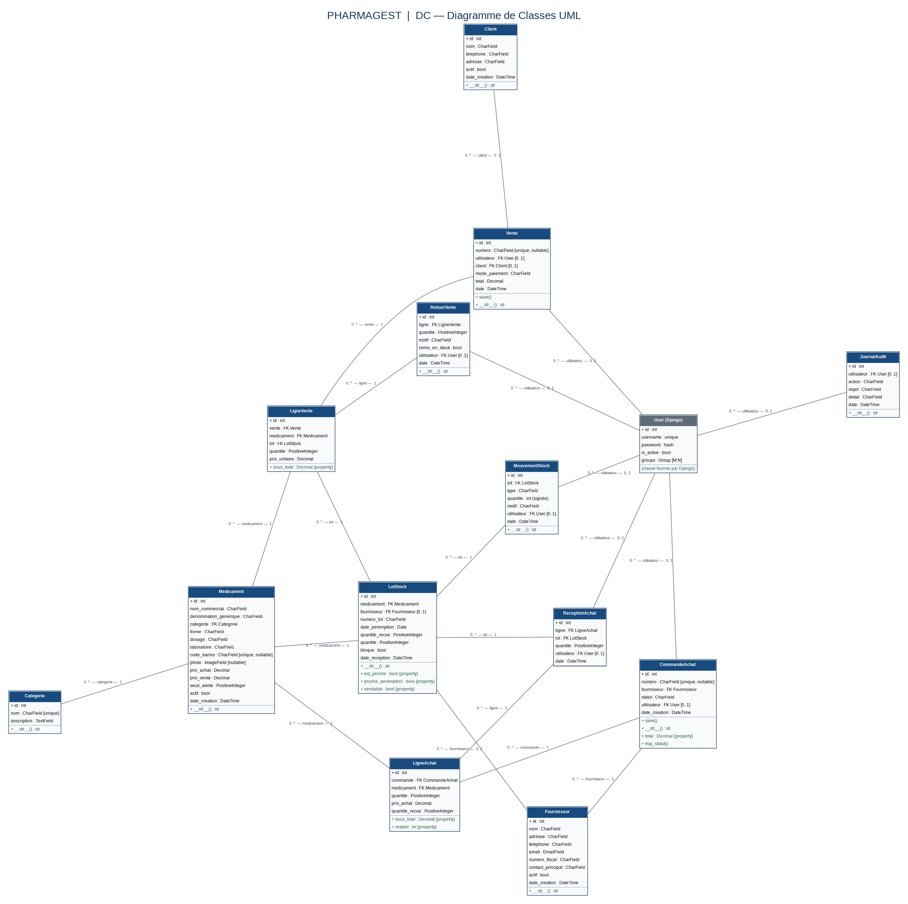

# PharmaGest

Application web de gestion de pharmacie développée avec **Django**.

Elle couvre le cycle complet de gestion d'une pharmacie : approvisionnement auprès des fournisseurs, suivi du stock par lots et dates de péremption, vente à la caisse, gestion des retours, génération de rapports PDF et traçabilité des opérations.

## 1. Contenu de l'archive

| Élément | Rôle |
|---|---|
| `manage.py` | Point d'entrée des commandes Django |
| `config/` | Configuration et adresses du projet |
| `medicaments/`, `fournisseurs/`, `clients/`, `achats/`, `stock/`, `ventes/`, `rapports/`, `utilisateurs/` | Applications Django : modèles, vues et formulaires |
| `templates/` | Pages HTML utilisant Bootstrap 5 |
| `db.sqlite3` | Base de données préremplie avec des données fictives |
| `media/` | Photos des médicaments |
| `docs/` | Guide d'utilisation et dossier de conception |
| `requirements.txt` | Liste des bibliothèques Python nécessaires |

## 2. Installation et lancement

### Prérequis

- Python 3.12 ou plus récent.
- Vérification de la version :

```bash
python --version
```

### Étapes d'installation

**1. Décompresser l'archive**

Ouvrir un terminal dans le dossier `PharmaGest`, celui qui contient le fichier `manage.py`.

**2. Créer un environnement virtuel**

```bash
python -m venv .venv
```

**3. Activer l'environnement virtuel**

Linux et macOS :

```bash
source .venv/bin/activate
```

Windows :

```bash
.venv\Scripts\activate
```

Le terminal affiche alors `(.venv)` au début de la ligne.

**4. Installer les dépendances**

```bash
pip install -r requirements.txt
```

Django, Pillow pour la gestion des photos et ReportLab pour la génération des PDF sont notamment utilisés.

**5. Lancer le serveur**

```bash
python manage.py runserver
```

**6. Accéder à l'application**

Ouvrir le navigateur à l'adresse :

http://127.0.0.1:8000/

La page de connexion s'affiche.

Pour arrêter le serveur, utiliser `Ctrl + C` dans le terminal.

La base de données et les photos étant déjà incluses dans l'archive, aucune migration ni création de données supplémentaire n'est nécessaire pour effectuer les tests avec la base fournie.

## 3. Comptes de test

| Compte | Mot de passe | Droits principaux |
|---|---|---|
| `pharmacien` | `Pharma2026!` | Accès complet à l'application |
| `gestionnaire` | `Pharma2026!` | Médicaments, fournisseurs, achats, réceptions, inventaire et rapports de stock |
| `caissier` | `Pharma2026!` | Caisse, ventes, reçus et retours |

Un utilisateur qui tente d'effectuer une action hors de ses autorisations est redirigé vers la page « Accès refusé ».

Pour accéder à l'administration Django (`/admin/`), créer un compte administrateur :

```bash
python manage.py createsuperuser
```

*Les identifiants fournis sont destinés exclusivement à la démonstration et aux tests.*

## 4. Fonctionnalités réalisées

### Gestion des médicaments et des référentiels
- Gestion CRUD des médicaments.
- Ajout et gestion des photos.
- Recherche, filtres par catégorie et pagination.
- Archivage des médicaments.
- Gestion des catégories.
- Gestion des fournisseurs : ajout, modification, recherche et désactivation.
- Gestion des clients et consultation de leur historique de ventes.

### Gestion des approvisionnements
- Création et suivi des commandes d'achat.
- Gestion des statuts : brouillon, commandée, partiellement réceptionnée, entièrement réceptionnée et annulée.
- Réception partielle des commandes.
- Gestion des lots et des quantités réceptionnées.
- Réception directe de marchandises.
- Mise à jour du stock uniquement lors de la réception effective.

### Gestion du stock
- Suivi du stock par lots.
- Gestion des dates de péremption.
- Alertes de rupture et de stock faible.
- Alertes sur les lots périmés ou proches de la péremption.
- Traçabilité des mouvements de stock.
- Inventaire physique et gestion des écarts par mouvements de correction.
- Blocage des lots non vendables.

### Gestion des ventes et des retours
- Panier de vente et gestion de la caisse.
- Vente avec client facultatif (vente comptoir).
- Déstockage automatique selon la méthode FEFO (*First Expired, First Out*).
- Gestion transactionnelle des ventes.
- Conservation du prix unitaire au moment de la vente.
- Refus des ventes lorsque le stock est insuffisant ou que le lot est périmé ou bloqué.
- Gestion des retours avec motif obligatoire.
- Remise en stock conditionnelle.
- Conservation de l'historique de la vente d'origine.

### Rapports et traçabilité
- Génération de reçus de vente PDF avec ReportLab.
- Rapports PDF sur le stock, les péremptions, les ventes et les achats.
- Journal d'audit : opérations, utilisateurs, dates et détails.
- Consultation du journal d'audit par le pharmacien.
- Sauvegarde et restauration de la base de données.
- Tableau de bord avec indicateurs et alertes.

### Sécurité et gestion des accès
- Authentification Django.
- Gestion des rôles : Pharmacien, Caissier et Gestionnaire de stock.
- Protection des pages et des opérations selon les autorisations.
- Page « Accès refusé » en cas de permission insuffisante.

## 5. Conception et modélisation

La conception de PharmaGest s'appuie sur la méthode **Merise** pour la modélisation des données et sur **UML** pour représenter la structure du système.

Les modèles présentés permettent de décrire l'organisation des données, les relations entre les différentes entités et la structure des classes métier de l'application.

### 5.1. Modèle conceptuel de données (MCD)

Le MCD présente les entités métier, leurs propriétés, les associations et les cardinalités.



### 5.2. Modèle logique de données (MLD)

Le MLD représente la traduction relationnelle du modèle conceptuel. Il met en évidence les tables, les clés primaires et les clés étrangères.



### 5.3. Diagramme de classes UML (DC)

Le diagramme de classes UML représente les principales classes du système, leurs attributs, leurs méthodes et leurs relations.



### 5.4. Dossier de conception

Le dossier détaillé est disponible dans le fichier [`docs/merise.md`](docs/merise.md).

Il comprend :
- Le dictionnaire des données.
- Le modèle conceptuel de données (MCD).
- Le modèle logique de données (MLD).
- Les associations et leurs cardinalités.
- Les règles de gestion et leur mise en œuvre.
- Les contraintes d'intégrité et les politiques de suppression.
- Les écarts identifiés par rapport au cahier des charges.

Les modèles de données sont définis dans les fichiers `models.py` des différentes applications Django. Le système d'authentification repose sur les mécanismes natifs de Django.

## 6. Parcours de test conseillé (10 minutes)

1. Se connecter avec le compte `pharmacien` et consulter le **tableau de bord** : ventes, alertes de stock, péremptions et rapports PDF.
2. Ouvrir un **médicament** pour consulter sa fiche et sa photo. Tester la recherche et le filtre par catégorie.
3. Aller dans **Achats** : créer une commande, la valider puis réceptionner une partie de la marchandise. Vérifier que le stock augmente uniquement lors de la réception.
4. Aller dans **Caisse** : vendre un médicament à un client, puis consulter le reçu PDF. Essayer de vendre une quantité supérieure au stock disponible.
5. Effectuer un **retour de vente** à partir d'un reçu en indiquant un motif.
6. Consulter le **Stock** : lots, mouvements et inventaire physique.
7. Revenir au tableau de bord et consulter le **journal d'audit** pour vérifier la traçabilité des opérations.
8. Se connecter avec le compte `caissier` et vérifier les restrictions d'accès aux fonctions de réception, d'inventaire et au journal d'audit.

## 7. Tests automatisés

Pour lancer les tests :

```bash
python manage.py test
```

Résultat attendu :

```text
Ran 24 tests ... OK
```

Les tests couvrent notamment :
- Les permissions et les rôles.
- Les ventes et la gestion du stock.
- Les achats et les réceptions.
- Les retours de vente.
- L'inventaire.
- Les rapports.

La durée d'exécution est d'environ quinze secondes, selon les performances de la machine.

## 8. Sauvegarde et restauration

PharmaGest intègre des commandes Django permettant de sauvegarder et de restaurer la base de données.

### Créer une sauvegarde

```bash
python manage.py sauvegarde
```

La sauvegarde est enregistrée dans le dossier `backups/` sous la forme :

`pharmagest-AAAAMMJJ-HHMMSS.sqlite3`

Les photos sont également sauvegardées dans une archive ZIP.

### Limiter le nombre de sauvegardes conservées

```bash
python manage.py sauvegarde --garder 5
```

### Restaurer une sauvegarde

```bash
python manage.py restaurer backups/pharmagest-AAAAMMJJ-HHMMSS.sqlite3
```

Avant toute restauration, la base de données actuelle est copiée dans un fichier `db.avant-restauration`.

Pour automatiser les sauvegardes quotidiennes, il est possible de planifier la commande avec Cron sous Linux ou le Planificateur de tâches sous Windows.

## 9. Repartir d'une base de données vide (facultatif)

Pour initialiser une nouvelle base de données :

1. Supprimer le fichier `db.sqlite3`.
2. Exécuter les commandes suivantes :

```bash
python manage.py migrate
python manage.py createsuperuser
python manage.py seed
python manage.py roles
```

Ces commandes permettent respectivement de créer les tables, de créer un compte administrateur, de charger des données fictives et de configurer les groupes et comptes de test.

## 10. Limites actuelles

Les fonctionnalités suivantes ne sont pas encore intégrées :

- Pas de paiement électronique vérifié : le mode de paiement est enregistré sans table de paiements séparée.
- Pas de génération de factures ni de bons de commande et de réception au format PDF. Seuls les reçus de vente et les rapports sont générés.
- Pas de fonctionnalité de réinitialisation du mot de passe par e-mail.
- Les sauvegardes sont déclenchées manuellement par commande ; leur planification doit être configurée avec Cron ou le Planificateur de tâches.
- Les paramètres actuels sont adaptés au développement (`DEBUG` actif et clé secrète dans `config/settings.py`). Une configuration sécurisée est nécessaire avant toute mise en production.

## 11. Technologies utilisées

| Technologie | Utilisation |
|---|---|
| Python 3.12+ | Langage de programmation |
| Django | Framework web |
| SQLite | Système de gestion de base de données |
| HTML / CSS | Structure et présentation des pages |
| Bootstrap 5 | Interface utilisateur responsive |
| Pillow | Gestion des images |
| ReportLab | Génération des documents PDF |
| Git / GitHub | Gestion du code source et versionnement |

---

**PharmaGest — Application web de gestion de pharmacie.**