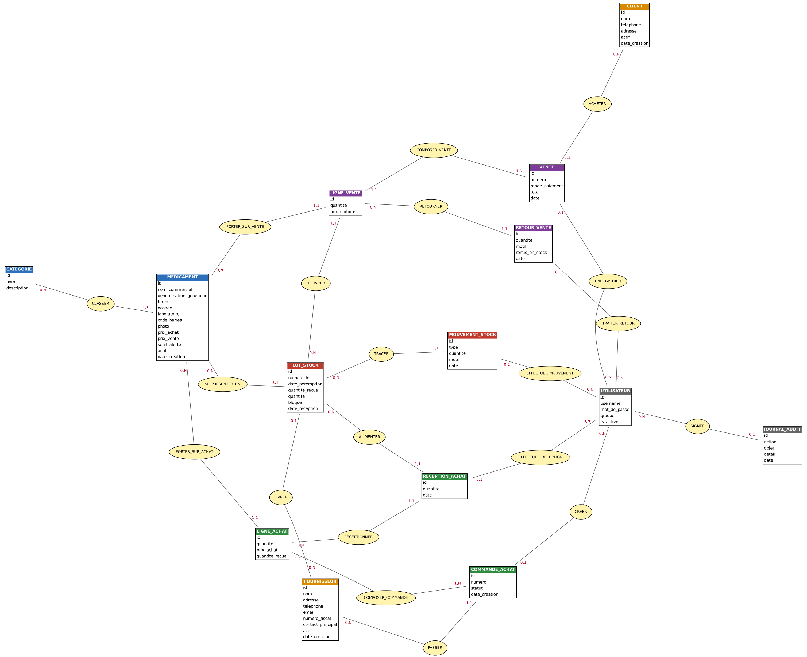

# Dossier de conception — PharmaGest (Merise)

Ce document complète le diagramme de classes UML (`docs/classes.png`). Il présente le MCD, le MLD et les règles de gestion de l'application, conformément au livrable n° 13 du cahier des charges.

- Schéma relationnel : `docs/mld.png`
- Diagramme de classes : `docs/classes.png`
- Source des modèles : fichiers `models.py` de chaque application.

## 1. Dictionnaire des données

| Entité | Attributs principaux | Identifiant |
|---|---|---|
| CATEGORIE | nom (unique), description | id |
| MEDICAMENT | nom_commercial, denomination_generique, forme, dosage, laboratoire, code_barres (unique), photo, prix_achat, prix_vente, seuil_alerte, actif, date_creation | id |
| FOURNISSEUR | nom, adresse, telephone, email, numero_fiscal, contact_principal, actif, date_creation | id |
| CLIENT | nom, telephone, adresse, actif, date_creation | id |
| UTILISATEUR | username, mot de passe (haché par Django), groupe (rôle), is_active | id |
| LOT_STOCK | numero_lot, date_peremption, quantite_recue, quantite (disponible), bloque, date_reception | id (unique : médicament + numero_lot) |
| MOUVEMENT_STOCK | type (entrée, sortie, retour, correction), quantite (signée), motif, date | id |
| COMMANDE_ACHAT | numero (unique), statut, date_creation | id |
| LIGNE_ACHAT | quantite, prix_achat, quantite_recue | id |
| RECEPTION_ACHAT | quantite, date | id |
| VENTE | numero (unique), mode_paiement, total, date | id |
| LIGNE_VENTE | quantite, prix_unitaire (prix figé au moment de la vente) | id |
| RETOUR_VENTE | quantite, motif, remis_en_stock, date | id |
| JOURNAL_AUDIT | action, objet, detail, date | id |

## 2. MCD (modèle conceptuel de données)



Notation Merise : les rectangles sont les entités (identifiant souligné), les ellipses sont les associations, et chaque lien porte la cardinalité **(min,max)** côté entité. Exemple : « MEDICAMENT (1,1) — CLASSER — CATEGORIE (0,N) » signifie qu'un médicament appartient à exactement une catégorie, et qu'une catégorie regroupe de 0 à N médicaments.

### Liste des associations et cardinalités

| N° | Association | Entité 1 (min,max) | Entité 2 (min,max) |
|---|---|---|---|
| 1 | CLASSER | MEDICAMENT (1,1) | CATEGORIE (0,N) |
| 2 | SE_PRESENTER_EN | LOT_STOCK (1,1) | MEDICAMENT (0,N) |
| 3 | LIVRER | LOT_STOCK (0,1) | FOURNISSEUR (0,N) |
| 4 | PASSER | COMMANDE_ACHAT (1,1) | FOURNISSEUR (0,N) |
| 5 | COMPOSER_COMMANDE | LIGNE_ACHAT (1,1) | COMMANDE_ACHAT (1,N) |
| 6 | PORTER_SUR_ACHAT | LIGNE_ACHAT (1,1) | MEDICAMENT (0,N) |
| 7 | RECEPTIONNER | RECEPTION_ACHAT (1,1) | LIGNE_ACHAT (0,N) |
| 8 | ALIMENTER | RECEPTION_ACHAT (1,1) | LOT_STOCK (0,N) |
| 9 | TRACER | MOUVEMENT_STOCK (1,1) | LOT_STOCK (0,N) |
| 10 | ACHETER | VENTE (0,1) | CLIENT (0,N) |
| 11 | COMPOSER_VENTE | LIGNE_VENTE (1,1) | VENTE (1,N) |
| 12 | PORTER_SUR_VENTE | LIGNE_VENTE (1,1) | MEDICAMENT (0,N) |
| 13 | DELIVRER | LIGNE_VENTE (1,1) | LOT_STOCK (0,N) |
| 14 | RETOURNER | RETOUR_VENTE (1,1) | LIGNE_VENTE (0,N) |
| 15 | CREER | COMMANDE_ACHAT (0,1) | UTILISATEUR (0,N) |
| 16 | ENREGISTRER | VENTE (0,1) | UTILISATEUR (0,N) |
| 17 | EFFECTUER_MOUVEMENT | MOUVEMENT_STOCK (0,1) | UTILISATEUR (0,N) |
| 18 | EFFECTUER_RECEPTION | RECEPTION_ACHAT (0,1) | UTILISATEUR (0,N) |
| 19 | TRAITER_RETOUR | RETOUR_VENTE (0,1) | UTILISATEUR (0,N) |
| 20 | SIGNER | JOURNAL_AUDIT (0,1) | UTILISATEUR (0,N) |

### Remarques de modélisation
- `LIGNE_ACHAT`, `LIGNE_VENTE` et `RECEPTION_ACHAT` sont des entités dépendantes de leur en-tête (identifiant relatif), car elles portent des attributs propres (quantité, prix figé) et sont elles-mêmes reliées à d'autres entités (`RETOUR_VENTE` se rattache à `LIGNE_VENTE`).
- `UTILISATEUR` correspond à la table d'authentification de Django (comptes, mots de passe hachés, groupes qui représentent les rôles).
- Le client est facultatif sur une vente (0,1) pour permettre la vente comptoir.
- Le fournisseur d'un lot est facultatif (0,1), car un lot peut être réceptionné directement sans commande.

### Reproduire le MCD dans Looping
1. Créer les 14 entités du dictionnaire (section 1) avec leurs attributs, `id` comme identifiant.
2. Créer chaque association du tableau ci-dessus et saisir les deux cardinalités.
3. Exporter le MLD : Looping applique les règles de transformation et produit les clés étrangères, qui doivent correspondre à la section 3.

## 3. MLD (modèle logique de données)

Notation : <u>clé primaire</u> soulignée, `#` pour une clé étrangère. Chaque clé étrangère reprend le « 1,1 » ou « 0,1 » de l'association correspondante.

```text
CATEGORIE        (id, nom, description)
MEDICAMENT       (id, nom_commercial, denomination_generique, #categorie_id, forme, dosage,
                  laboratoire, code_barres, photo, prix_achat, prix_vente, seuil_alerte,
                  actif, date_creation)
FOURNISSEUR      (id, nom, adresse, telephone, email, numero_fiscal, contact_principal,
                  actif, date_creation)
CLIENT           (id, nom, telephone, adresse, actif, date_creation)
UTILISATEUR      (id, username, password, is_active, ...)   -- auth_user de Django + groupes
LOT_STOCK        (id, #medicament_id, #fournisseur_id, numero_lot, date_peremption,
                  quantite_recue, quantite, bloque, date_reception)
                  UNIQUE (medicament_id, numero_lot)
MOUVEMENT_STOCK  (id, #lot_id, type, quantite, motif, #utilisateur_id, date)
COMMANDE_ACHAT   (id, numero, #fournisseur_id, statut, #utilisateur_id, date_creation)
LIGNE_ACHAT      (id, #commande_id, #medicament_id, quantite, prix_achat, quantite_recue)
RECEPTION_ACHAT  (id, #ligne_id, #lot_id, quantite, #utilisateur_id, date)
VENTE            (id, numero, #client_id, #utilisateur_id, mode_paiement, total, date)
LIGNE_VENTE      (id, #vente_id, #medicament_id, #lot_id, quantite, prix_unitaire)
RETOUR_VENTE     (id, #ligne_id, quantite, motif, remis_en_stock, #utilisateur_id, date)
JOURNAL_AUDIT    (id, #utilisateur_id, action, objet, detail, date)
```

Contraintes d'unicité : `CATEGORIE.nom`, `MEDICAMENT.code_barres` (si renseigné), `COMMANDE_ACHAT.numero`, `VENTE.numero`, `LOT_STOCK (medicament_id, numero_lot)`.

Politique de suppression (clé étrangère) :
- `PROTECT` sur les médicaments, lots, lignes, fournisseurs et catégories utilisés : l'historique ne peut pas être effacé (RG10). Un médicament ou un fournisseur est archivé (`actif = False`).
- `SET NULL` sur les utilisateurs et les clients : si un compte ou un client est supprimé, l'opération conservée reste lisible.
- `CASCADE` uniquement entre un en-tête et ses lignes (commande → lignes, vente → lignes).

## 4. Règles de gestion et leur mise en œuvre

| Code | Règle | Mise en œuvre |
|---|---|---|
| RG01 | Identifiant unique par médicament | clé primaire automatique |
| RG02 | Code-barres non dupliqué | `unique=True` sur `code_barres` |
| RG03 | Prix et quantités validés côté serveur | validateurs de modèle et formulaires Django |
| RG04 | Une commande ne modifie pas le stock | seule la réception crée un lot ou un mouvement |
| RG05 | Une réception augmente le stock une fois | transaction atomique, `quantite_recue` plafonnée à la quantité commandée |
| RG06 | Une vente diminue le stock une fois | transaction atomique, un mouvement de type « sortie » |
| RG07 | Stock jamais négatif | quantité entière positive, contrôle avant validation, inventaire refusant les valeurs négatives |
| RG08 | Lots périmés ou bloqués exclus | propriété `vendable` du lot, FEFO |
| RG09 | Auteur et date conservés | champs `utilisateur` et `date` sur les opérations, table `JOURNAL_AUDIT` |
| RG10 | Pas de suppression silencieuse | `PROTECT`, archivage, retours compensatoires |
| RG11 | Accès selon les droits | rôles (groupes) et page « Accès refusé » (403) |
| RG12 | Prix historiques conservés | `LIGNE_VENTE.prix_unitaire` et `LIGNE_ACHAT.prix_achat` figés |

## 5. Écarts assumés avec le cahier des charges

Ces éléments sont signalés dans le README (section « Limites actuelles ») :
- Le paiement n'a pas de table séparée : le mode de paiement et le total sont portés par `VENTE`, sans vérification de paiement électronique.
- Pas de factures ni de bons de commande et de réception en PDF (reçu de vente et rapports uniquement).
- Pas de réinitialisation du mot de passe par e-mail.
