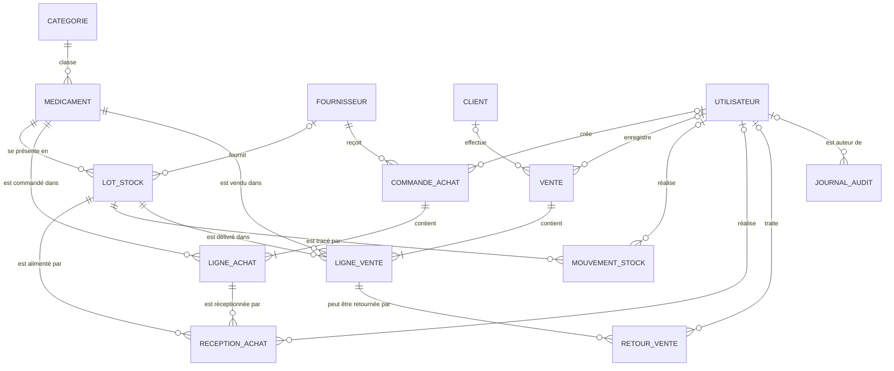

# Dossier de conception — PharmaGest (Merise)

Ce document complète le diagramme de classes UML (`docs/classes.png`). Il présente le MCD, le MLD et les règles de gestion de l'application, conformément au livrable n° 13 du cahier des charges.

- Schéma relationnel : `docs/mld.png`
- Diagramme de classes : `docs/classes.png`
- Source des modèles : fichiers `models.py` de chaque application.

## 1. Dictionnaire des données

| Entité | Attributs principaux | Identifiant |
|---|---|---|
| CATEGORIE | nom (unique), description | id |
| MEDICAMENT | nom_commercial, denomination_generique, forme, dosage, laboratoire, code_barres (unique), photo, prix_achat, prix_vente, seuil_alerte, actif, date_creation | id |
| FOURNISSEUR | nom, adresse, telephone, email, numero_fiscal, contact_principal, actif, date_creation | id |
| CLIENT | nom, telephone, adresse, actif, date_creation | id |
| UTILISATEUR | username, mot de passe (haché par Django), groupe (rôle), is_active | id |
| LOT_STOCK | numero_lot, date_peremption, quantite_recue, quantite (disponible), bloque, date_reception | id (unique : médicament + numero_lot) |
| MOUVEMENT_STOCK | type (entrée, sortie, retour, correction), quantite (signée), motif, date | id |
| COMMANDE_ACHAT | numero (unique), statut, date_creation | id |
| LIGNE_ACHAT | quantite, prix_achat, quantite_recue | id |
| RECEPTION_ACHAT | quantite, date | id |
| VENTE | numero (unique), mode_paiement, total, date | id |
| LIGNE_VENTE | quantite, prix_unitaire (prix figé au moment de la vente) | id |
| RETOUR_VENTE | quantite, motif, remis_en_stock, date | id |
| JOURNAL_AUDIT | action, objet, detail, date | id |

## 2. MCD (modèle conceptuel de données)

Les cardinalités se lisent « côté entité : minimum, maximum ».



Lecture des principales cardinalités :

| Association | Côté gauche | Côté droit |
|---|---|---|
| CATEGORIE — MEDICAMENT | un médicament a 1,1 catégorie | une catégorie regroupe 0,N médicaments |
| MEDICAMENT — LOT_STOCK | un lot concerne 1,1 médicament | un médicament a 0,N lots |
| FOURNISSEUR — COMMANDE_ACHAT | une commande a 1,1 fournisseur | un fournisseur a 0,N commandes |
| COMMANDE_ACHAT — LIGNE_ACHAT | une ligne appartient à 1,1 commande | une commande a 1,N lignes |
| CLIENT — VENTE | une vente a 0,1 client (vente comptoir possible) | un client a 0,N ventes |
| VENTE — LIGNE_VENTE | une ligne appartient à 1,1 vente | une vente a 1,N lignes |
| LIGNE_VENTE — RETOUR_VENTE | un retour concerne 1,1 ligne | une ligne a 0,N retours |

## 3. MLD (modèle logique de données)

Notation : <u>clé primaire</u> soulignée, `#` pour une clé étrangère. Chaque clé étrangère reprend le « 1,1 » ou « 0,1 » de l'association correspondante.

```text
CATEGORIE        (id, nom, description)
MEDICAMENT       (id, nom_commercial, denomination_generique, #categorie_id, forme, dosage,
                  laboratoire, code_barres, photo, prix_achat, prix_vente, seuil_alerte,
                  actif, date_creation)
FOURNISSEUR      (id, nom, adresse, telephone, email, numero_fiscal, contact_principal,
                  actif, date_creation)
CLIENT           (id, nom, telephone, adresse, actif, date_creation)
UTILISATEUR      (id, username, password, is_active, ...)   -- auth_user de Django + groupes
LOT_STOCK        (id, #medicament_id, #fournisseur_id, numero_lot, date_peremption,
                  quantite_recue, quantite, bloque, date_reception)
                  UNIQUE (medicament_id, numero_lot)
MOUVEMENT_STOCK  (id, #lot_id, type, quantite, motif, #utilisateur_id, date)
COMMANDE_ACHAT   (id, numero, #fournisseur_id, statut, #utilisateur_id, date_creation)
LIGNE_ACHAT      (id, #commande_id, #medicament_id, quantite, prix_achat, quantite_recue)
RECEPTION_ACHAT  (id, #ligne_id, #lot_id, quantite, #utilisateur_id, date)
VENTE            (id, numero, #client_id, #utilisateur_id, mode_paiement, total, date)
LIGNE_VENTE      (id, #vente_id, #medicament_id, #lot_id, quantite, prix_unitaire)
RETOUR_VENTE     (id, #ligne_id, quantite, motif, remis_en_stock, #utilisateur_id, date)
JOURNAL_AUDIT    (id, #utilisateur_id, action, objet, detail, date)
```

Contraintes d'unicité : `CATEGORIE.nom`, `MEDICAMENT.code_barres` (si renseigné), `COMMANDE_ACHAT.numero`, `VENTE.numero`, `LOT_STOCK (medicament_id, numero_lot)`.

Politique de suppression (clé étrangère) :
- `PROTECT` sur les médicaments, lots, lignes, fournisseurs et catégories utilisés : l'historique ne peut pas être effacé (RG10). Un médicament ou un fournisseur est archivé (`actif = False`).
- `SET NULL` sur les utilisateurs et les clients : si un compte ou un client est supprimé, l'opération conservée reste lisible.
- `CASCADE` uniquement entre un en-tête et ses lignes (commande → lignes, vente → lignes).

## 4. Règles de gestion et leur mise en œuvre

| Code | Règle | Mise en œuvre |
|---|---|---|
| RG01 | Identifiant unique par médicament | clé primaire automatique |
| RG02 | Code-barres non dupliqué | `unique=True` sur `code_barres` |
| RG03 | Prix et quantités validés côté serveur | validateurs de modèle et formulaires Django |
| RG04 | Une commande ne modifie pas le stock | seule la réception crée un lot ou un mouvement |
| RG05 | Une réception augmente le stock une fois | transaction atomique, `quantite_recue` plafonnée à la quantité commandée |
| RG06 | Une vente diminue le stock une fois | transaction atomique, un mouvement de type « sortie » |
| RG07 | Stock jamais négatif | quantité entière positive, contrôle avant validation, inventaire refusant les valeurs négatives |
| RG08 | Lots périmés ou bloqués exclus | propriété `vendable` du lot, FEFO |
| RG09 | Auteur et date conservés | champs `utilisateur` et `date` sur les opérations, table `JOURNAL_AUDIT` |
| RG10 | Pas de suppression silencieuse | `PROTECT`, archivage, retours compensatoires |
| RG11 | Accès selon les droits | rôles (groupes) et page « Accès refusé » (403) |
| RG12 | Prix historiques conservés | `LIGNE_VENTE.prix_unitaire` et `LIGNE_ACHAT.prix_achat` figés |

## 5. Écarts assumés avec le cahier des charges

Ces éléments sont signalés dans le README (section « Limites actuelles ») :
- Le paiement n'a pas de table séparée : le mode de paiement et le total sont portés par `VENTE`, sans vérification de paiement électronique.
- Pas de factures ni de bons de commande et de réception en PDF (reçu de vente et rapports uniquement).
- Pas de réinitialisation du mot de passe par e-mail.
